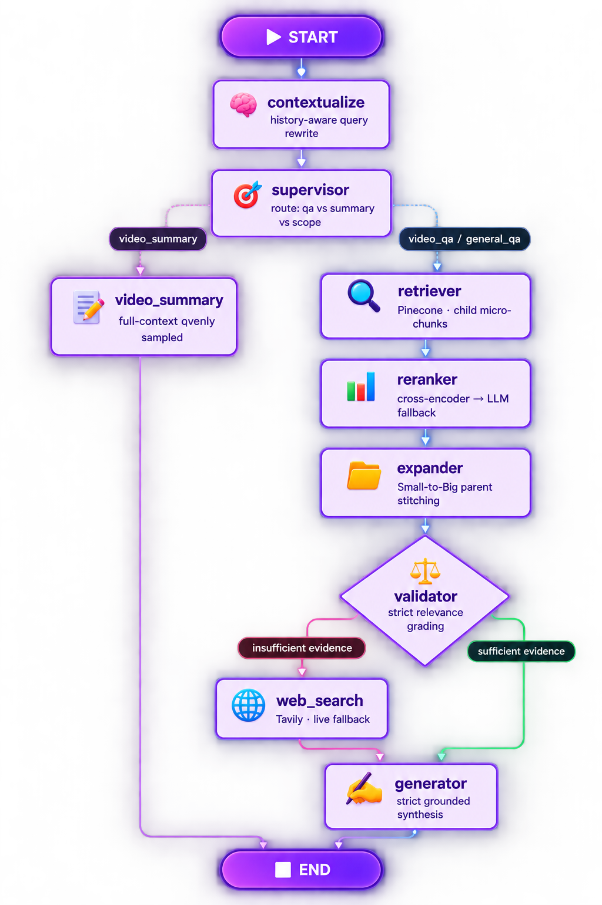
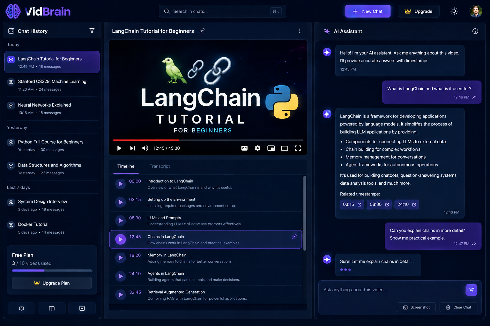
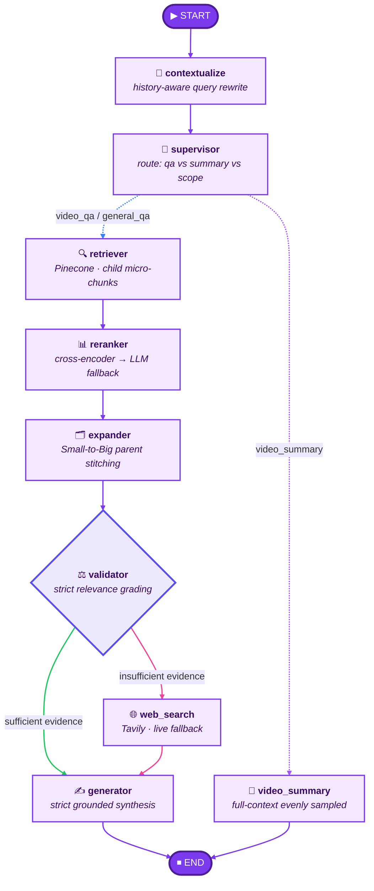

<div align="center">

# 🧠 VidBrain — Agentic Workflow Architecture

**Single-Flight ingestion · Small-to-Big retrieval · Strict anti-hallucination grading**

<p>
  
  
  
  
</p>



</div>

---

## 📑 Contents

- [UI preview](#-ui-preview)
- [Overview](#-overview)
- [Graph](#-graph)
- [Node reference](#-node-reference)
- [Pre-graph: Single-Flight ingestion](#-0-single-flight-ingestion-engine)
- [Node deep-dive](#-node-deep-dive)
- [How `video_summary` differs](#-how-video_summary-differs)

---

## 🖼️ UI preview

<div align="center">



<sub><b>Left:</b> chat history &nbsp;·&nbsp; <b>Center:</b> video player with clickable timeline &nbsp;·&nbsp; <b>Right:</b> AI assistant with timestamped answers</sub>

</div>

---

## ✨ Overview

Every query is resolved against conversational memory, routed, retrieved as precise **micro-chunks**, reranked, expanded to full continuous context, and **strictly graded** before generation. Live web search is used **only** when local evidence is insufficient.

| Stage | What it guarantees |
| :-- | :-- |
| 🚀 Ingestion | One expensive LLM/embedding run per video, even under viral traffic |
| 🔍 Retrieval | Hyper-precise hits from small chunks, full context from parent passages |
| ⚖️ Validation | No blended or hallucinated answers: bad evidence never reaches the generator |
| ✍️ Generation | Every citation snapped to a real transcript timestamp |

---

## 🗺️ Graph



> [!TIP]
> **Legend:** 🟣 main flow · 🔵 Q&A route · 🟪 summary route · 🩷 fallback to web · 🟢 evidence accepted

---

## 🧩 Node reference

| # | Node | Role | Key technique |
| :-: | :-- | :-- | :-- |
| 0 | 🚀 **Ingestion** *(pre-graph)* | Deduplicate viral video processing | Postgres lock · Single-Flight |
| 1 | 🧠 **contextualize** | Standalone question from chat history | Sliding budget window · Pydantic output |
| 2 | 🎯 **supervisor** | Pick the runtime path | `search_scope` routing |
| 3 | 🔍 **retriever** | Fetch precise child chunks | Pinecone · 2-line windows · `k=24/40` |
| 4 | 📊 **reranker** | Filter noise | `ms-marco-MiniLM-L-6-v2` → LLM fallback |
| 5 | 🗂️ **expander** | Rebuild full context | Parent passages · edge stitching |
| 6 | ⚖️ **validator** | Anti-hallucination guardrail | Strict binary grading |
| 7 | 🌐 **web_search** | Live fallback | Tavily · exponential backoff |
| 8 | ✍️ **generator** | Grounded answer + citations | Snap Tolerance (15 s) |

---

## 🚀 0. Single-Flight Ingestion Engine

**Viral video deduplication** *(pre-graph pipeline)*

When hundreds of users request the same trending video at once, a **Distributed Lock & Single-Flight Request** pattern makes sure the expensive work happens exactly once.

```text
 user A ──► claim_video()  ──► wins the lock ──► LLM + embeddings ──► ready
 user B ──► claim_video()  ──► lock taken ─────► wait_until_ready (non-blocking poll)
 user C ──► cache hit ─────────────────────────► link_user_video (ACL via join table)
```

- 🔒 A deterministic Postgres lock (`claim_video`) lets only the **first** user trigger ingestion.
- ⏳ Concurrent requests enter a non-blocking `wait_until_ready` polling state.
- ⚡ Later users get a **cache hit** and are granted access through a join table (`link_user_video`).
- 💰 **Zero duplicate vectors** are stored, which saves compute and storage.

---

## 🔬 Node deep-dive

<details>
<summary><b>🧠 1. Contextualize — conversational memory</b></summary>

<br>

The entry point of the graph.

- Pulls the **last 4 turns** of chat history using a **Sliding Budget Window** (truncated to avoid token bloat).
- Resolves the raw message into a **standalone question**.
- Guards against pronoun drift and uses strict **Pydantic structured outputs** to prevent conversational gaps.

</details>

<details>
<summary><b>🎯 2. Supervisor & Router</b></summary>

<br>

Decides the runtime path from the resolved query. It inspects `search_scope` and chooses between:

- 🎬 searching **locally** inside one video boundary,
- 🌍 searching **globally** across all collections,
- 📝 going straight to **structured summarization**.

</details>

<details>
<summary><b>🔍 3. Pinecone Retriever — Small-to-Big, phase 1</b></summary>

<br>

- Retrieves **child micro-chunks** (overlapping 2-line sliding windows) instead of large text blocks, for sub-linear, hyper-precise semantic hits without context dilution.
- Injects a cheap **contextual header** (the video title) to resolve coreferences with no LLM overhead.
- Intentionally **over-fetches** candidates (`k=24` or `40`) for the reranker.

</details>

<details>
<summary><b>📊 4. Reranker — noise filtering</b></summary>

<br>

- Scores every child chunk against the resolved query with a lightweight local cross-encoder (`ms-marco-MiniLM-L-6-v2`).
- **Auto-fallback:** if the server lacks the RAM to load the PyTorch model, it falls back to an LLM-based reranking chain.
- Trims the candidates down to the top-N best hits.

</details>

<details>
<summary><b>🗂️ 5. Parent Expander — Small-to-Big, phase 2</b></summary>

<br>

Takes the top-ranked child chunks and runs a **single `IN` query** against Supabase to fetch their context-rich **parent passages** (10-line blocks).

- 🧵 **Edge stitching:** if the answer sits on a chunk boundary, lines from neighboring parents are stitched in to prevent *boundary context loss*.
- ⏱️ **Precise UI timestamps:** the LLM reads the large parent passage, but the metadata timestamp stays locked to the micro-child's hit time, so the frontend jumps to the exact second the answer appears.

</details>

<details>
<summary><b>⚖️ 6. Content Validator — the guardrail</b></summary>

<br>

- Grades the expanded passages against the resolved query with a **strict binary score**.
- If evidence is insufficient, it flags the graph state and routes **away from local context entirely**, which prevents blended or hallucinated answers.

</details>

<details>
<summary><b>🌐 7. Tavily Web Search — fallback</b></summary>

<br>

- Triggered only when local assets fail validation.
- Runs live web search wrapped in **exponential-backoff retries**.
- Feeds clean factual data back into the generator state and transparently flags the UI that the response is **web-sourced**.

</details>

<details>
<summary><b>✍️ 8. Generator — strict grounded synthesis</b></summary>

<br>

- Synthesizes the answer using **only validated context**.
- **Snap Tolerance:** if the LLM invents a timestamp that doesn't exist in the transcript, or is off by more than **15 seconds**, the citation is dropped or snapped to the nearest real marker.
- Outputs structured **JSON** containing chronological, clickable UI cards.

</details>

---

## 📝 How `video_summary` differs

> [!IMPORTANT]
> The `video_summary` node does **not** use the shared Pinecone retrieval pipeline.

Instead of a vector similarity search, it fetches the **entire transcript** (parent chunks) directly from Postgres. To avoid **context window overflow** on long videos, it applies an **even-sampling algorithm** across the timeline, so the summary covers the **beginning, middle, and end** of the video.

```text
 transcript:  |■■■■■■■■■■■■■■■■■■■■■■■■■■■■■■■■■■■■■■■■|
 sampled:      ■   ■   ■   ■   ■   ■   ■   ■   ■   ■   ■
               ▲                   ▲                   ▲
             start               middle                end
```
